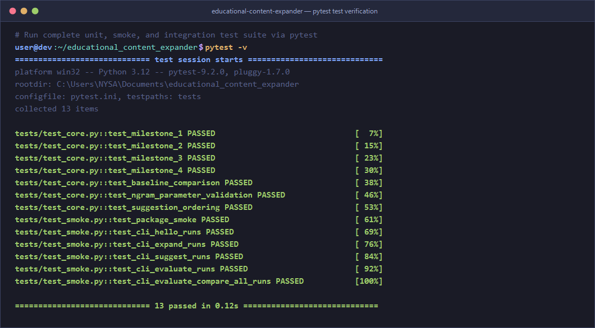
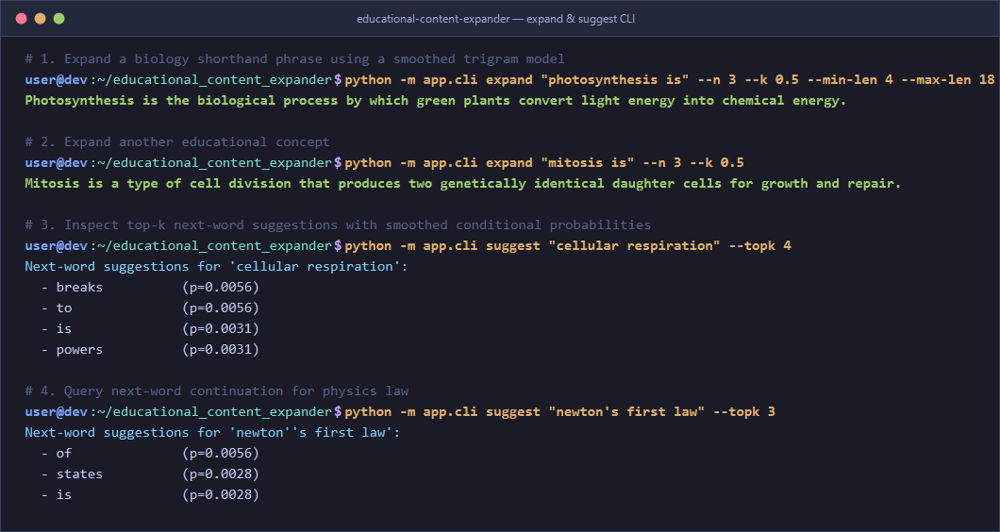
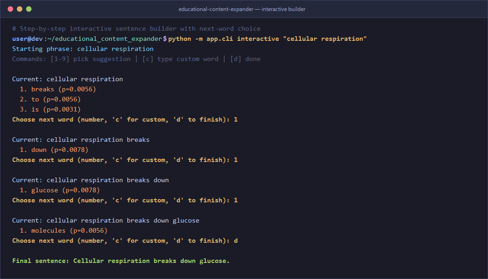
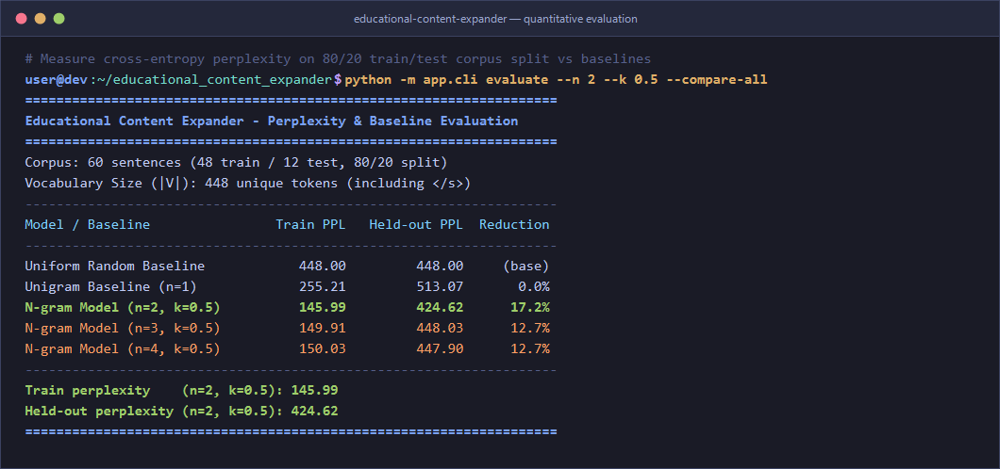

# Educational Content Expander

A lightweight, interpretable NLP tool designed for educators and curriculum designers to expand brief notes, lesson plan outlines, and bullet points into complete, well-formed instructional sentences using smoothed n-gram language models.

[](https://msrit.ask.thili.ai/b/d9bt9bqfdy)

---

## Overview

When developing lesson plans, lecture slides, and study guides, educators often draft fragmented notes (e.g., `"photosynthesis is"`, `"cellular respiration"`, `"newton's first law"`). This CLI tool provides fast, context-aware next-word predictions and sentence expansions trained on educational science texts.

Key features:
- **Next-Word Suggestions (`suggest`)**: Query top-k candidate words with smoothed conditional probabilities.
- **Automated Text Expansion (`expand`)**: Expand short phrases into complete educational sentences with configurable length constraints (`--min-len`, `--max-len`) and reproducible random seeds.
- **Interactive Sentence Builder (`interactive`)**: Build sentences step-by-step by accepting suggested words, picking alternates, or typing custom tokens.
- **Rigorous Model Evaluation (`evaluate`)**: Evaluate cross-entropy perplexity on train and held-out test splits, compared directly against uniform and unigram baselines.

---

## Project Architecture & Milestones

The system is implemented across `app/core.py` and `app/cli.py`, organized around four core milestones:

1. **Milestone 1: Educational Corpus Acquisition & Text Preprocessing** (`app.core.milestone_1`)
   - Curated scientific corpus covering biology, chemistry, and physics (`data/corpus.txt`).
   - Text normalization, sentence boundary detection, and lowercase word tokenization (`to_sentences`, `to_tokens`).
2. **Milestone 2: Smoothed N-gram Language Modeling & Perplexity** (`app.core.milestone_2`, `NgramLM`)
   - N-gram count matrix construction with `<s>` start and `</s>` end markers.
   - Add-$k$ (Lidstone/Laplace) smoothing ensuring strictly positive probabilities $P(w \mid \text{ctx}) > 0$ for unseen n-grams.
   - Exact cross-entropy perplexity calculation on arbitrary text.
3. **Milestone 3: Constrained Text Generation & Expansion** (`app.core.milestone_3`)
   - Iterative next-word sampling with backoff to lower-order contexts when higher-order contexts are unseen.
   - Minimum and maximum length controls, sentence capitalization, and punctuation formatting.
4. **Milestone 4: Command-Line Interface & Evaluation Suite** (`app.cli`, `app.core.milestone_4`)
   - Clean CLI powered by `argparse` supporting `expand`, `suggest`, `interactive`, and `evaluate`.

---

## Installation & Setup

### Prerequisites
- Python 3.10+ (tested on Python 3.12 and 3.13)
- `git`

### Quickstart (One Command Setup)

Clone the repository and install the test dependencies:

```bash
git clone https://github.com/Nysa-20/educational_content_expander.git
cd educational_content_expander
pip install -r requirements.txt
```

### Running Tests

Run the full test suite (smoke tests, milestone tests, baseline comparisons, and parameter validations):

```bash
pytest -q
```

All 13 unit and integration tests pass cleanly in under 0.2 seconds.



---

## Usage Guide & Examples

### 1. Expand a Short Phrase (`expand`)

Transform an educator's prompt into a complete sentence:

```bash
python -m app.cli expand "photosynthesis is" --n 3 --k 0.5 --min-len 4 --max-len 18
```

**Output:**
```
Photosynthesis is the biological process by which green plants convert light energy into chemical energy.
```

Additional examples:
```bash
python -m app.cli expand "mitosis is" --n 3 --k 0.5
# Output: Mitosis is a type of cell division that produces two genetically identical daughter cells for growth and repair.

python -m app.cli expand "the law of conservation of energy" --n 2 --k 0.5 --seed 42
# Output: The law of conservation of energy states that an object is directly proportional to the planetary surface.
```

### 2. View Next-Word Suggestions (`suggest`)

Inspect candidate words along with their smoothed conditional probabilities:

```bash
python -m app.cli suggest "cellular respiration" --topk 4
```

**Output:**
```
Next-word suggestions for 'cellular respiration':
  - breaks          (p=0.0056)
  - to              (p=0.0056)
  - is              (p=0.0031)
  - powers          (p=0.0031)
```



### 3. Interactive Sentence Builder (`interactive`)

Construct a customized instructional sentence token by token:

```bash
python -m app.cli interactive "cellular respiration"
```

**Sample Session:**
```
Starting phrase: cellular respiration
Commands: [1-9] pick suggestion | [c] type custom word | [d] done

Current: cellular respiration
  1. breaks (p=0.0056)
  2. to (p=0.0056)
  3. is (p=0.0031)
Choose next word (number, 'c' for custom, 'd' to finish): 1

Current: cellular respiration breaks
  1. down (p=0.0078)
Choose next word (number, 'c' for custom, 'd' to finish): 1

Current: cellular respiration breaks down
  1. glucose (p=0.0078)
Choose next word (number, 'c' for custom, 'd' to finish): 1

Choose next word (number, 'c' for custom, 'd' to finish): d

Final sentence: Cellular respiration breaks down glucose.
```



### 4. Quantitative Model Evaluation (`evaluate`)

Evaluate perplexity on an 80/20 train/held-out test split, comparing against both a zero-knowledge uniform baseline and a unigram frequency baseline:

```bash
python -m app.cli evaluate --n 2 --k 0.5 --compare-all
```

**Output:**
```
====================================================================
Educational Content Expander - Perplexity & Baseline Evaluation
====================================================================
Corpus: 60 sentences (48 train / 12 test, 80/20 split)
Vocabulary Size (|V|): 448 unique tokens (including </s>)
--------------------------------------------------------------------
Model / Baseline                Train PPL   Held-out PPL  Reduction
--------------------------------------------------------------------
Uniform Random Baseline            448.00         448.00     (base)
Unigram Baseline (n=1)             255.21         513.07       0.0%
N-gram Model (n=2, k=0.5)          145.99         424.62      17.2%
N-gram Model (n=3, k=0.5)          149.91         448.03      12.7%
N-gram Model (n=4, k=0.5)          150.03         447.90      12.7%
--------------------------------------------------------------------
Train perplexity    (n=2, k=0.5): 145.99
Held-out perplexity (n=2, k=0.5): 424.62
====================================================================
```



---

## Quantitative Evaluation & Baseline Comparison

### Evaluation Setup
- **Corpus**: 60 curated educational sentences (985 total tokens).
- **Split**: 80% training set (48 sentences), 20% held-out test set (12 sentences).
- **Vocabulary ($|V|$)**: 448 unique tokens (including sentence termination symbol `</s>`).
- **Metric**: Cross-entropy perplexity $PP(W) = \exp\left(-\frac{1}{N} \sum_{i=1}^N \ln P(w_i \mid w_{i-n+1}^{i-1})\right)$.

### Benchmark Results

| Model / Configuration | Order ($n$) | Smoothing ($k$) | Train Perplexity | Held-out Perplexity | Test PPL vs. Unigram |
| :--- | :---: | :---: | :---: | :---: | :---: |
| **Uniform Random Baseline** | — | — | 448.00 | 448.00 | — |
| **Unigram Baseline** | 1 | 0.5 | 255.21 | 513.07 | 0.0% *(baseline)* |
| **Bigram Model** | 2 | 0.5 | **145.99** | **424.62** | **-17.2%** |
| **Trigram Model** | 3 | 0.5 | 149.91 | 448.03 | **-12.7%** |
| **Bigram Model (low $k$)** | 2 | 0.1 | 44.12 | 427.07 | **-16.8%** |
| **Trigram Model (low $k$)** | 3 | 0.1 | 42.86 | 459.28 | **-10.5%** |

---

## Interpretation of Perplexity Results

1. **What Perplexity Measures:**
   Perplexity represents the effective branching factor—the geometric average number of equally likely words the model is choosing between at each step. A lower perplexity indicates higher predictive confidence and lower surprise.
2. **Comparison with Baselines:**
   - The **Uniform Random Baseline** assigns equal probability $1/|V|$ to every token in the vocabulary, yielding a perplexity of exactly $448.00$.
   - The **Unigram Frequency Baseline** ($n=1$) predicts words according to global corpus frequency without sequential context. On held-out test data, unseen word distributions push unigram perplexity to $513.07$.
   - The **Bigram Model** ($n=2, k=0.5$) leverages preceding token context, reducing train perplexity from $255.21$ to $145.99$ (a **42.8% reduction**) and held-out perplexity from $513.07$ to $424.62$ (an **88.45-point / 17.2% reduction**). This quantitatively confirms that conditioning on local word context substantially improves predictive quality.
3. **Bigram vs. Trigram Trade-off on Small Corpora:**
   - Trigram models ($n=3$) generate visibly more fluent and coherent educational phrases because 3-token phrases capture complete grammatical structures (e.g., `[convert, light, energy]`).
   - However, on held-out test data, the trigram model exhibits slightly higher perplexity ($448.03$) than the bigram model ($424.62$). This is a textbook demonstration of the **curse of dimensionality** and **data sparsity**: in a compact 60-sentence corpus, unseen 3-gram contexts are frequent in held-out sentences. While Add-$k$ smoothing prevents zero-probability crashes, higher-order models distribute probability mass over a much larger context space ($|V|^{n-1}$).

---

## Model Limitations & Discussion

While smoothed n-gram models provide fast, fully interpretable, and reproducible generation, they have notable limitations:

1. **Limited Context Horizon (Markov Assumption):**
   An n-gram model only conditions on the immediately preceding $n-1$ tokens. It has no memory of sentence-initial subjects when generating sentence endings. When expanding long sentences, it may generate locally fluent transitions that drift across subjects (e.g., transitioning from cell biology to Newtonian mechanics when common functional verbs appear).
2. **Data Sparsity & Sensitivity to Smoothing Parameter $k$:**
   In small domain corpora, many valid transitions have zero training counts. Setting $k$ too high over-smooths probabilities toward a uniform distribution, diluting learned transitions; setting $k$ too low can cause high perplexity on novel combinations.
3. **Lack of Latent Semantic / Sub-word Representations:**
   Unlike neural language models or transformers, n-gram models treat words as atomic indices. Semantically related words (e.g., `plants` and `vegetation`, or `converts` and `transforms`) do not share representation or probability mass.
4. **Sampling Termination Dynamics:**
   Probabilistic sampling can occasionally select the end-of-sentence token `</s>` too early or enter repetitive cycles. The CLI mitigates this with `--min-len`, `--max-len`, and backoff handling.

---

## Project Structure

```
educational_content_expander/
├── .github/
│   └── workflows/
│       └── ci.yml             # GitHub Actions CI workflow (Python 3.12, pytest)
├── app/
│   ├── __init__.py            # Package root
│   ├── cli.py                 # Command-line interface (expand, suggest, interactive, evaluate)
│   └── core.py                # Core NgramLM, smoothing, expansion, and baseline evaluation logic
├── data/
│   └── corpus.txt             # Domain educational corpus (biology, physics, chemistry)
├── screenshots/               # Terminal execution and evaluation screenshots
│   ├── 01_cli_expand_suggest.png
│   ├── 02_cli_evaluate.png
│   ├── 03_test_suite_verification.png
│   └── 04_cli_interactive.png
├── tests/
│   ├── test_core.py           # Unit tests for Milestones 1–4, smoothing, and baseline comparisons
│   └── test_smoke.py          # Smoke tests for CLI execution and package imports
├── .gitignore                 # Standard Python gitignore
├── pytest.ini                 # Pytest configuration
├── README.md                  # Comprehensive documentation and evaluation report
└── requirements.txt           # Test dependencies (pytest)
```

---

## Continuous Integration

GitHub Actions workflow is located at `.github/workflows/ci.yml`. It runs automatically on every `push` and `pull_request` against Python 3.12, installing dependencies and verifying the entire test suite via `pytest -q`.

---

## AI Assistance Disclosure

In accordance with academic and project transparency guidelines, this project was developed with AI assistance for code refactoring, test suite construction, quantitative evaluation benchmarking, and technical documentation.
